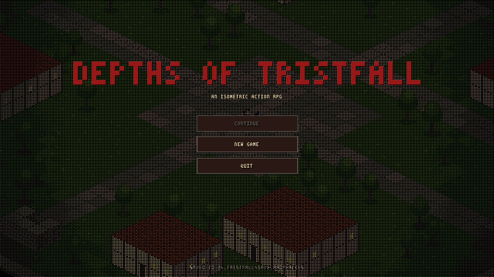
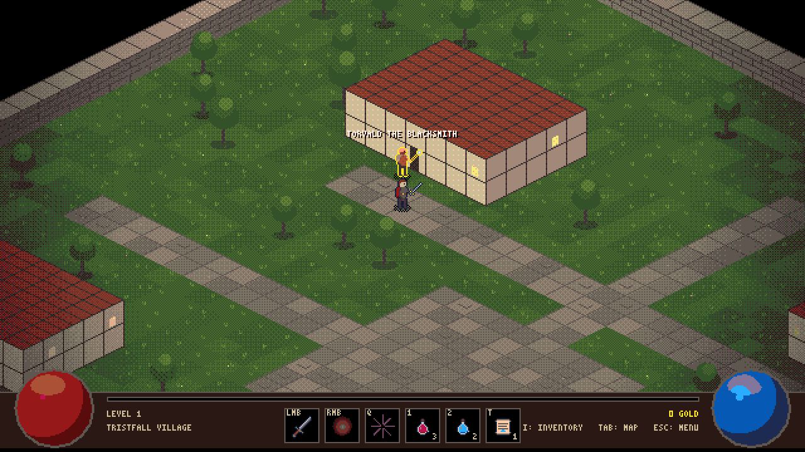
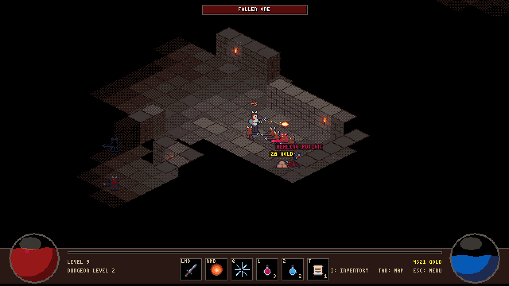
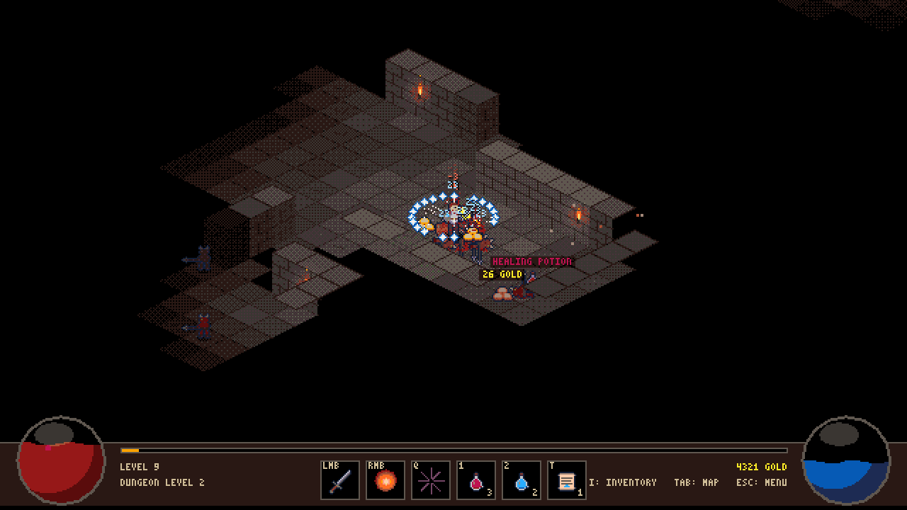
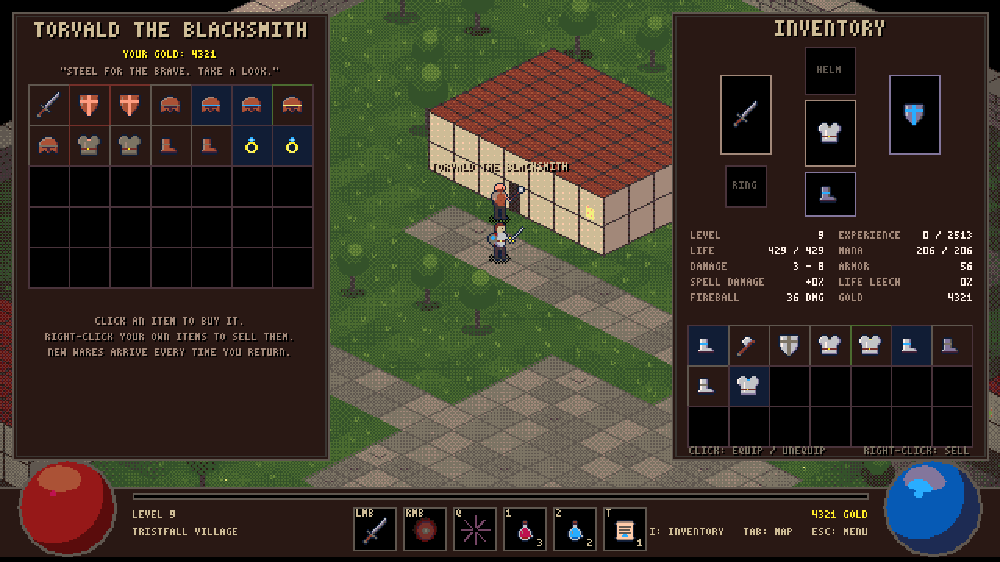
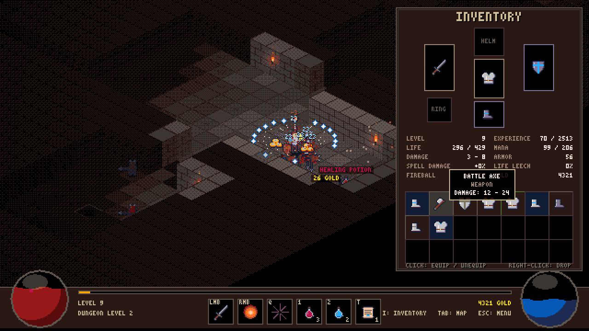

# Depths of Tristfall

A small isometric action RPG in the spirit of the original *Diablo*, written in plain Java with Swing.
There are no external assets or libraries: every sprite, tile, font glyph, sound effect and music track is
generated in code at runtime.



## Screenshots

### Tristfall Village
Start in town, talk to Torvald the Blacksmith for gear and Maren the Healer for potions and a free heal,
then head for the stairs at the south end of the village.



### The dungeon
Randomly generated levels lit by torches and your own light radius. Fight Fallen Ones, Zombies,
Skeletons and Skeleton Archers, and watch out for champion packs and the boss waiting on every third level.





### Gear and shops
Monsters drop gold, potions, scrolls and equipment in four rarities (normal, magic, rare, unique) for six slots.
Sell what you don't need and buy upgrades in town; the blacksmith's stock is refreshed every time you return.





## Features

- Isometric dungeons generated per level, with an automap and fog of war
- Melee combat plus two spells: **Fireball** and **Frost Nova** (slows enemies)
- Health and mana orbs, potions, experience and levelling
- Loot with random affixes (life, mana, damage, armor, spell damage, life leech)
- Town portal scrolls and waypoints every few levels
- Save / load (autosaves when you return to town and on exit)
- Retro look: the world is rendered at half resolution, dithered to a fixed palette and scaled up with hard pixels
- Procedurally synthesized sound effects and music

## Running

Requires a JDK 17 or newer on your `PATH`.

**Windows**

```bat
run.bat
```

**Any platform**

```sh
javac -d out src/game/*.java
java -cp out game.Main
```

The save file is stored at `~/.tristfall/save.properties`. Pass `-Dtristfall.save=<path>` to use a different location.

## Controls

| Input | Action |
| --- | --- |
| Left click | Move / attack / pick up / talk (hold to keep going) |
| Right click | Fireball (7 mana) |
| `Q` | Frost Nova (16 mana) |
| `1` / `2` | Drink a healing / mana potion |
| `T` | Read a Scroll of Town Portal |
| `I` or `C` | Inventory and character sheet |
| `Tab` | Automap |
| `F5` / `F9` | Quick save / quick load |
| `M` | Music on / off |
| `H` or `F1` | Toggle help |
| `Esc` | Close panels / pause menu |

## Project layout

All source lives in `src/game`:

| File | Purpose |
| --- | --- |
| `Main.java` | Window setup and entry point |
| `GamePanel.java` | Game loop, rendering, input, UI |
| `Dungeon.java`, `Level.java` | Town and dungeon generation, per-level state |
| `Player.java`, `Monster.java`, `Npc.java`, `Creature.java` | Characters |
| `Item.java`, `Loot.java`, `ItemDrop.java` | Items and loot tables |
| `Pathfinder.java` | Pathfinding for the player and monsters |
| `PixelArt.java`, `PixelSprites.java`, `Sprites.java`, `PixelFont.java`, `Retro.java` | Procedural pixel art and the retro render pipeline |
| `Audio.java`, `Synth.java` | Procedural sound and music |
| `SaveGame.java` | Save file reading and writing |
